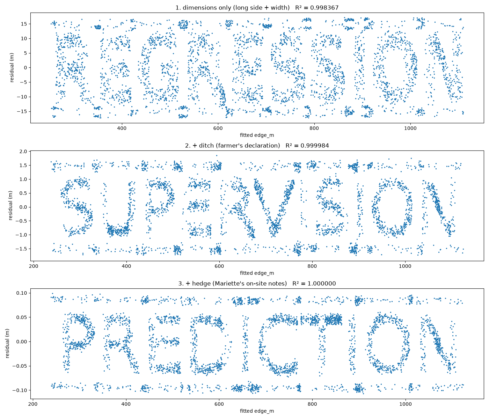

# Belgium · Fry-ndship

**Flag recovered:** `SIGMOID_PREDICTION`

## Run
```bash
cd task_Belgium && python main.py   # prints R² per model, writes residuals.png
```

## The idea
A high R² doesn't mean the model is right. The residuals still have structure. Fit a linear model for `edge_m` and plot residuals against values. Each time you add the missing term, the residual plot spells a new word at a smaller scale:

| Model (linear, no extra terms) | R² | Residual scale | Word |
|---|---|---|---|
| long side + width (`width = area·10⁴ / long_side`) | 0.9984 | +- 15 m | REGRESSION |
| + `ditch_m` (declared) | 0.99998 | +-1.5 m | SUPERVISION |
| + `hedge_m` (Mariette's on-site notes) | 0.99999994 | +-0.1 m | **PREDICTION** |

The final model is `edge = 0.82·(long + width) + ditch + hedge`. The first two words serve as decoys kind of, which were left by under-fitted models. The word Mariette's own measurements reveal is the deepest layer, **PREDICTION**.


